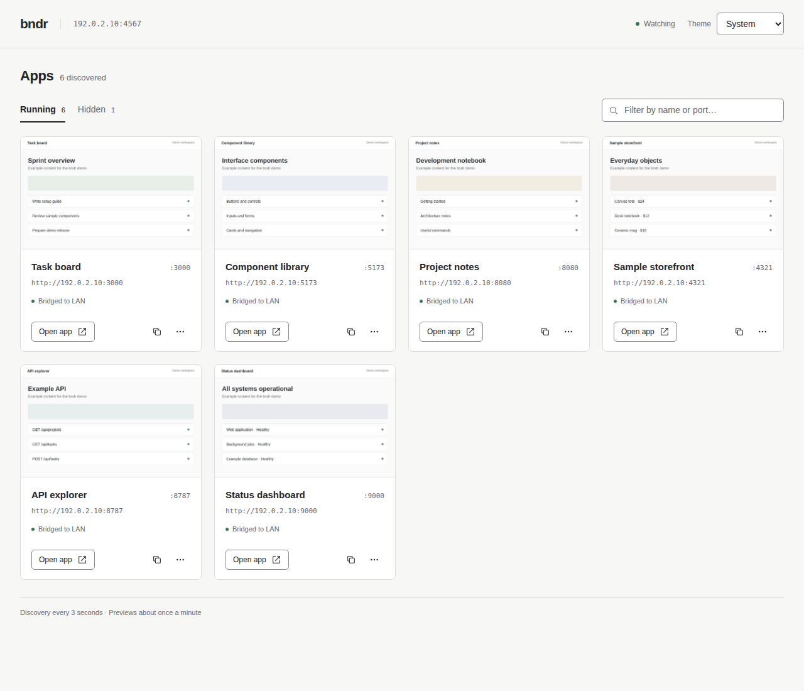

# bndr

A lightweight Linux dashboard that makes local HTTP development servers available on your LAN. Start an app from Claude Code, Codex, a terminal, or any other tool; bndr discovers the listening socket and adds a link to the dashboard.



## Install a published release

For a public repository, users can install a published release without Go, Node, or sudo:

```sh
curl -fsSL https://github.com/tonyrowles/bndr/releases/latest/download/install.sh -o /tmp/bndr-install.sh
sh /tmp/bndr-install.sh
~/.local/bin/bndr
```

The installer selects the Linux x86-64 or ARM64 binary, verifies its SHA-256 checksum, and installs into `~/.local/bin`. Add that directory to `PATH` to use `bndr` by name. Downloads and checksums come from the same versioned GitHub release. Chromium is optional and installed separately for thumbnails.

For a background service that starts when your user session starts:

```sh
sh /tmp/bndr-install.sh --service
```

This enables and starts a user systemd service. It does not modify system-wide services or enable login lingering. If you need it to run before login or after logout, configure user lingering separately with your system administrator. The service retries on failure, including when the LAN interface is not ready yet.

Edit `~/.config/bndr/bndr.env` (or `$XDG_CONFIG_HOME/bndr/bndr.env`) for `BNDR_HOST`, `BNDR_PORT`, exclusions, or a Chromium path, then restart:

```sh
systemctl --user restart bndr
journalctl --user -u bndr -f
```

Running a second foreground instance on the same port will conflict with an active service.

Rerun the installer to update; include `--service` to restart a running service with the new binary. Service configuration and saved app settings are preserved. To pin a version or choose a directory:

```sh
sh /tmp/bndr-install.sh --version v0.2.0 --bin-dir /absolute/path/to/bin
```

To uninstall the binary and user service, keeping names, hidden settings and service configuration:

```sh
sh /tmp/bndr-install.sh --uninstall
```

Use the same `--bin-dir` when uninstalling a custom installation. Offline installation is supported with `--archive /path/to/bndr_linux_amd64.tar.gz` (or the ARM64 archive); keep the matching `SHA256SUMS` alongside it.

For a private repository, authenticate with GitHub CLI and download the release first:

```sh
gh release download v0.2.0 --repo tonyrowles/bndr --dir /tmp/bndr-release --pattern 'bndr_linux_*.tar.gz' --pattern SHA256SUMS --pattern install.sh
sh /tmp/bndr-release/install.sh --archive /tmp/bndr-release/bndr_linux_amd64.tar.gz
```

Use the ARM64 archive on ARM machines. Unauthenticated installer downloads require the repository to be public.

## Run from source

bndr is a Go application with its dashboard embedded in a single binary. Running a built binary does not require Go or Node.js. Linux is required for socket discovery.

Build with Go 1.26.10 or newer (the pinned toolchain is Go 1.27.3):

```sh
make build
./bin/bndr
```

Or run directly from source:

```sh
go run .
```

The LAN address is detected automatically. To select a specific interface:

```sh
BNDR_HOST=192.168.1.50 ./bin/bndr
```

The default dashboard port is 4567. To keep an existing dashboard URL after upgrading, set `BNDR_PORT=4000`.

Open `http://192.168.1.50:4567` from another device on the same LAN. Assign that address to the dev machine using a DHCP reservation or your Linux network configuration. If `BNDR_HOST` is omitted, bndr selects the first non-loopback IPv4 interface; set it explicitly on machines with VPNs or multiple interfaces.

Start a local server, for example:

```sh
python3 -m http.server 8765 --bind 127.0.0.1
```

Within a few seconds, the dashboard links to `http://192.168.1.50:8765`. bndr binds that LAN address on port 8765 and proxies to the loopback listener. Already exposed IPv4 servers get direct links. HTTP request bodies, streaming responses and WebSocket upgrades pass through. Removing an app removes its bridge at the next scan.

## Configuration

| Variable | Default | Purpose |
| --- | --- | --- |
| `BNDR_HOST` | First external IPv4 address | Assigned LAN address for dashboard and bridges |
| `BNDR_PORT` | `4567` | Dashboard port |
| `BNDR_EXCLUDE` | Empty | Comma-separated ports to skip, e.g. `8080,9090` |
| `BNDR_DATA_DIR` | `$XDG_STATE_HOME/bndr` or `~/.local/state/bndr` | Directory containing persistent app settings |
| `BNDR_PREVIEWS` | Enabled | Set to `0` to disable screenshot browsing entirely |
| `BNDR_CHROMIUM` | Auto-detected | Path to a Chromium or Chrome executable for thumbnails |
| `BNDR_CHROMIUM_NO_SANDBOX` | Unset | Set to `1` only in an isolated environment where Chromium sandboxing is unavailable |

Allow the dashboard port and app ports through your host firewall if needed. Run bndr as your normal user. Ports requiring extra privileges may show a binding error.

## Chromium for thumbnails

Install Chromium or Google Chrome with your Linux distribution's package manager. bndr finds common executable names on `PATH`, or you can set an explicit path:

```sh
BNDR_CHROMIUM=/usr/bin/chromium ./bin/bndr
```

Existing Chromium downloads in `~/.cache/ms-playwright` are also detected, so an installation from the previous Node version can be reused without keeping Node or Playwright installed. A custom browser cache location can be supplied using `PLAYWRIGHT_BROWSERS_PATH`.

Without a browser, discovery, names, hidden cards and forwarding still work; thumbnail cards explain that Chromium is needed. Thumbnails use [chromedp](https://github.com/chromedp/chromedp) to control Chromium over a private pipe, without a browser debugging port on the network.

## Dashboard themes

The header’s **Theme** control offers **System**, **Light**, and **Dark**. System follows the device’s appearance setting, including changes while the page is open. An explicit selection is saved in that browser and applies on the next visit. App settings continue to be saved on the dev machine.

The dashboard opens directly to the app list. Filter by name, port, or address; open an app from its title, thumbnail, or **Open app** button. The copy icon copies the LAN URL. The **App options** menu contains rename and hide/restore actions.

## Names, previews and hidden apps

Each card’s **App options** menu has **Rename** and **Hide app** controls. Custom names and hidden settings are saved on the dev machine in `apps.json` inside the data directory and survive bndr and app restarts. Clear the custom name or choose **Use page title**, then save, to follow the page title again.

Settings are keyed by port: if a different project later uses that port, it inherits those settings. Apps that move to a new port get new settings.

The **Hidden** tab shows hidden cards with a **Restore app** action, including saved entries for apps that are currently offline. Hiding only changes the dashboard; it does not stop the app or disable LAN access. Use `BNDR_EXCLUDE` to prevent exposure of a port. Hidden apps do not get screenshot captures.

HTML apps get cached JPEG screenshots captured on the dev machine, with one shared headless Chromium browser and one page at a time. Captures refresh about once a minute; they are not interactive embedded pages. Each capture uses an isolated browser context without your usual browser's login cookies. Pages requiring login may show their login screen. Non-HTML services and capture failures show a fallback card. If Chromium is missing, the dashboard and app forwarding still work and the preview indicates that Chromium needs to be installed. Screenshots are held in memory and discarded when apps disappear or are hidden.

## Scope and access

bndr reads `/proc/net/tcp` and `/proc/net/tcp6` in its current network namespace and probes HTTP `/` with a one-second timeout every three seconds. Any HTTP response qualifies, including login pages and errors. It does not depend on which agent or terminal started the process. Apps are automatically named from their HTML page title, including client-rendered titles once a preview is captured. Apps without titles fall back to a port label. The dashboard does not depend on agent-specific integration.

Client access to the dashboard, API, previews, and bndr-managed bridges is restricted by default to the subnet(s) assigned to the exact IP bndr binds to. For example, binding to `192.168.1.50/24` allows `192.168.1.0/24`; other local interfaces and private networks are not automatically trusted. bndr checks the connection’s source IP, ignores forwarded-IP headers, logs the allowed networks at startup, and refuses to start if it cannot determine the bound address’s subnet. Restart bndr after changing the interface address or netmask.

A Tailscale subnet router using source NAT can provide remote access: bndr sees the router’s LAN source address, and Tailscale policies should control access to that route. Without source NAT, a remote tailnet source address outside the bound subnet is denied. Binding directly to a Tailscale `/32` address does not allow other tailnet addresses.

This restriction applies only to listeners managed by bndr. Apps already listening directly on the LAN remain subject to their own access controls. Source-subnet checks do not authenticate users and cannot distinguish LAN clients from traffic that another device translates to an allowed source address; a host firewall remains useful.

The dashboard and bndr-managed bridges accept only their configured LAN IP and port in the HTTP Host header. Access through custom DNS names, reverse proxies that preserve a different Host, or the wrong port is rejected. This limits DNS rebinding; it does not authenticate LAN clients. Already-public apps linked directly by bndr retain their own security behavior.

Screenshot requests are filtered to the captured app’s exact scheme, literal IP address, and port. Other ports, hostnames, external sites, off-origin redirects, and off-origin frame/resource requests are blocked. A preview-only Content Security Policy also restricts connections and disables workers, popups, forms, plugins, and downloads. The app’s existing enforcing CSP is retained. These restrictions do not change the app served through its normal LAN link.

Local scripts, styles, images, and same-origin API calls can render. External CDNs, APIs, fonts, embedded sites, worker-dependent rendering, and login redirects to another origin may be absent or fail in thumbnails. Each intercepted document is limited to 8 MiB, and captures fail rather than proceeding without the filter if setup or interception fails.

This is browser-level request filtering, not an OS-enforced network sandbox. It does not contain browser exploits or provide complete control over browser-internal networking or protocols such as WebRTC. For untrusted app content, use `BNDR_PREVIEWS=0` or stronger network isolation; keep Chromium sandboxing enabled when previews are used.

**Use on a trusted LAN:** bndr automatically exposes discovered HTTP services, including development admin endpoints, without adding authentication, subject to the source-subnet restriction above for bndr-managed listeners. Use `BNDR_EXCLUDE` for ports you want kept local. It does not modify firewall rules or assign IP addresses.

HTTPS-only services, Unix sockets, other network namespaces and containers without published host ports are outside this first version. IPv6 loopback and wildcard listeners are probed over IPv6 and bridged to IPv4 when possible. Servers with custom Host/Origin checks, hardcoded localhost URLs, secure cookies, absolute redirects or hardcoded WebSocket URLs may need app configuration. HTTP Host is forwarded as `localhost:<port>`; Origin is preserved. Network discovery itself makes a GET request to `/` on candidate ports.

See the [security audit](docs/security-audit-2026-10-24.md) for verified findings and the status of local fixes versus published releases.

Stop with Ctrl+C to close the dashboard and all bridges. For persistent operation, run the same command under your preferred service manager with a fixed `BNDR_HOST`.

## Verify

```sh
go test ./...
go test -race ./...
go vet ./...
```

Tests cover Linux socket parsing, HTTP forwarding, upgrade tunneling, title parsing, concurrent preference updates, persistence across restart, hide/restore including offline entries, API validation, real screenshot capture, checksum failure, installer upgrades, online release selection, user-service generation, uninstall preservation, theme persistence, preview origin boundaries and redirect blocking, worker/popup restrictions, compressed and oversized preview documents, and keeping keyboard focus and drafts intact during dashboard polling. The real screenshot integration test runs when Chromium is available and otherwise reports a skip. The screenshot test disables the browser sandbox for compatibility with isolated CI environments; normal operation uses Chromium’s default sandbox.

## Migration from Node

Existing `apps.json` settings are read directly with no conversion. Custom names and hidden states keep the same port-based identity. The dashboard and `/api/apps` endpoints remain compatible. Stop the Node process before starting the Go binary so it can bind port 4567 and the app bridge ports.

## Build and publish a release

```sh
make release VERSION=v0.2.0
```

This creates static Linux x86-64 and ARM64 archives, the installer, and `SHA256SUMS` in `dist/`. Archives include the embedded dashboard, README and dependency notices. Check a local package without changing your main installation:

```sh
sh install.sh --archive dist/bndr_linux_amd64.tar.gz --bin-dir /tmp/bndr-release-test
/tmp/bndr-release-test/bndr --version
```

The release workflow runs tests and the race detector, builds both architectures, smoke-tests the installer, and publishes the assets when a version tag is pushed to GitHub. After committing and pushing the code, a maintainer can publish with:

```sh
git tag v0.2.0
git push origin v0.2.0
```

Tags such as `v0.2.0-rc.1` create prereleases, which the default installer skips. A specific prerelease can be installed with `--version`. The default online installer requires a stable release in a public repository; use the authenticated download method above for a private repository.
